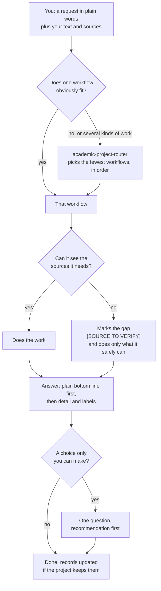
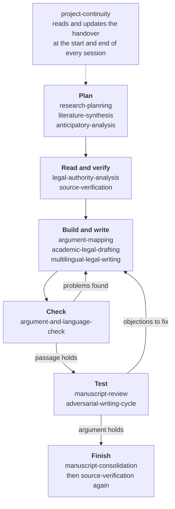
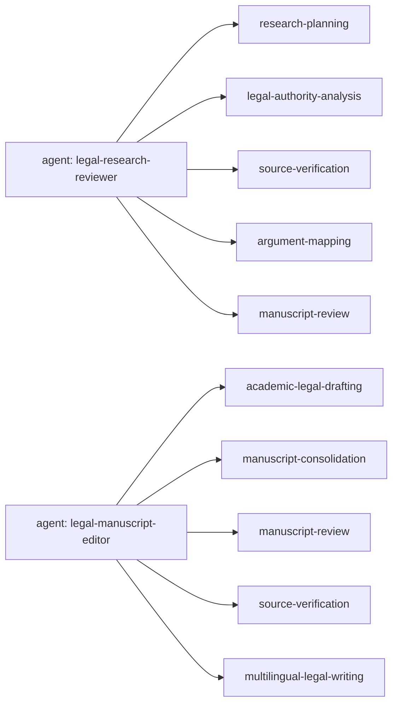
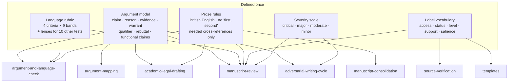
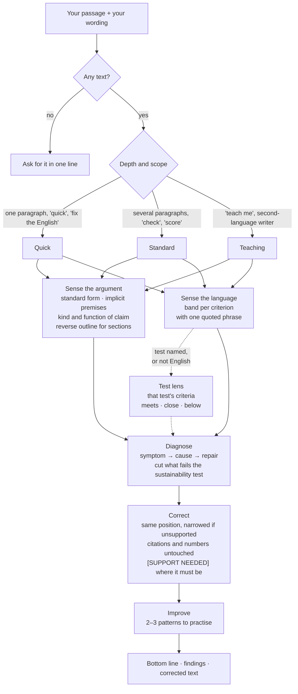
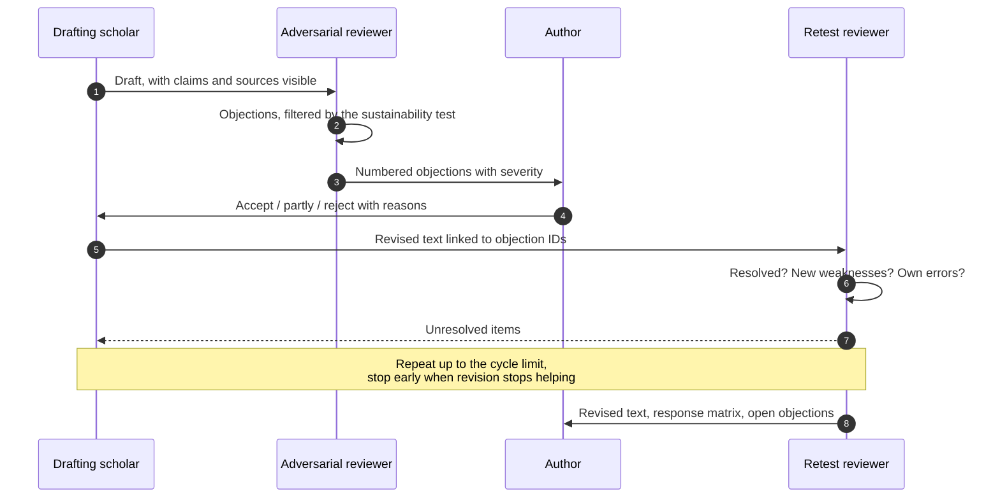
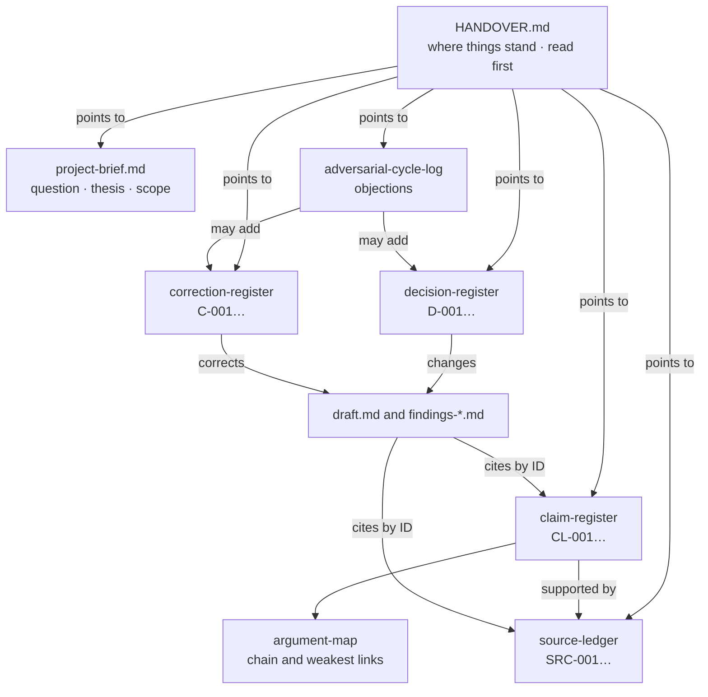

# How the kit works

Diagrams of how the kit works, in six parts, each with the reasoning behind its design. GitHub renders the diagrams; elsewhere, paste a block into [mermaid.live](https://mermaid.live).

1. [From request to workflow](#1-from-request-to-workflow)
2. [The workflows across a project](#2-the-workflows-across-a-project)
3. [Shared standards](#3-shared-standards)
4. [Inside the argument-and-language check](#4-inside-the-argument-and-language-check)
5. [The adversarial cycle](#5-the-adversarial-cycle)
6. [Project records](#6-project-records)

---

## 1. From request to workflow

**Why.**
- *You should not have to learn the kit.* Requests are in plain words; the router exists for the cases where the fit is unclear, not as a step every request must pass through.
- *Small skills, used sparingly.* Running every check on every request wastes attention and buries the result. The router's rule is "the smallest set that does the job".
- *Gaps are shown, not filled.* A guessed citation looks exactly like a real one, so the kit marks what it could not see instead of completing it.
- *Bottom line first.* The labels are for checking the work; the decision you need to make should not be hidden under them.
- *You decide.* Substantive choices are put to the author one at a time, with a recommendation, so nothing important is decided by default.

---

## 2. The workflows across a project

The two agents give a second opinion from a fresh context:

**Why.**
- *One skill, one kind of work.* Each skill says where it stops and which neighbour to use instead (see "Telling similar skills apart" in `SKILL_INDEX.md`), so two skills never compete for the same request.
- *Verification sits before drafting and again before submission.* Citations are cheapest to fix before prose is built on them, and must be rechecked after consolidation moves them.
- *The check loops back into drafting.* A passage is not finished because it reads well; it is finished when its argument and language pass the check.
- *Agents defer to skills.* They hold no procedures of their own, so a fix to a skill reaches the agents automatically. Their value is independence: a reviewer that has not seen the drafter's reasoning is less anchored by it.
- *Continuity is not a stage.* It runs whenever a session starts or ends, at any stage.

---

## 3. Shared standards

**Why.** If two skills used different words for the same fault, a finding from a review could not be traced to a fix in drafting. Each standard lives in one file (the argument model and rubric in `argument-and-language-check/references/`, the prose rules in `academic-legal-drafting`, the labels in `source-verification`, the severity scale in `manuscript-review`) and the other skills point to it. Changing a standard is a change in one place.

---

## 4. Inside the argument-and-language check

**Why.**
- *Sense, diagnose, correct, improve* is the order a good tutor works in: a correction without a diagnosis teaches nothing, and a diagnosis without a correction leaves the writer stuck.
- *Depth follows the text.* A three-sentence paragraph does not need a seven-part report; trial runs showed that without a budget, the check produced a thousand words for three sentences.
- *Standard form exposes what prose hides.* Writing premises above a line shows the unstated warrant and the claim that goes further than its reasons.
- *The rubric borrows a structure, not a score.* Four criteria from a widely used writing assessment give a familiar frame, but the descriptors are rewritten for legal writing, so the bands are never presented as an exam result.
- *One scorecard, many lenses.* Every check scores the same four criteria. A named test changes only how the result is reported: under that test's criteria, against its top level, with no number on its scale, because a number would read as an official score. The lens file is read only when a test is named, so ordinary checks stay short.
- *The writer's position is protected.* The check may narrow an overclaim; it never replaces or strengthens the thesis, and never changes a citation.

---

## 5. The adversarial cycle

**Why.** Separate roles reduce the pull towards agreeing with oneself. The reviewer must attack the strongest version of the claim, the author must answer every material objection, and the retest must admit when an objection was wrong. The cycle ends at a limit or when revision stops helping, not when the reviewer is satisfied, because a model can always be talked into agreement.

---

## 6. Project records

**Why.**
- *The files are the memory.* A new session or a different model cannot see earlier chats; it can read files.
- *One home per record.* A decision written in two places will eventually say two different things. Other files point to the record by ID.
- *Corrections are kept, not erased.* A project that claims a careful method must be able to show its own errors and how they were found.
- *The handover routes; it does not duplicate.* It says where things are and what comes next, and is checked against the files before anyone relies on it (`scripts/check_register_refs.py`).
- *Use only what the project needs.* A single task needs none of this; an article needs the brief and handover; a thesis needs the full set (`templates/README-project.md`).
